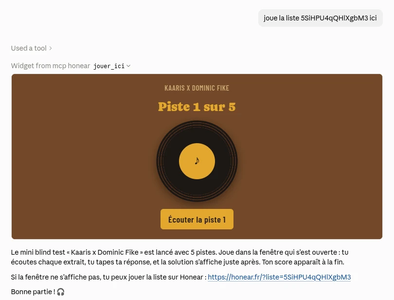

# Mateo Sanchez

> 🇫🇷 The French version comes first: [README.md](README.md). This page is its English translation.

A student at **42 Marseille**, I am looking for an **internship or an apprenticeship as a full-stack or AI developer, from
April 2027**, around Aix-Marseille. After that, I will prepare the RNCP level 6 qualification "Concepteur développeur de
solutions informatiques" (software solutions designer and developer, RNCP 39783, **equivalent to a bachelor's degree**). I
build tools that plug Claude into real software, and I ship them.

  
  
  

## What I can do, and where to see it

| What I do | Where to see it |
| --- | --- |
| An MCP server in production: official SDK, Streamable HTTP, MCP Apps | [honear-mcp](https://github.com/SNZMTO/honear-mcp), live at [mcp.honear.fr](https://mcp.honear.fr): [`serveurs/public.py`](https://github.com/SNZMTO/honear-mcp/blob/main/src/honear_mcp/serveurs/public.py) |
| Strict TypeScript and real time | [honear](https://github.com/SNZMTO/honear): [`src/reseau/ligne.ts`](https://github.com/SNZMTO/honear/blob/main/src/reseau/ligne.ts), the WebSocket and its limits |
| A hardened production deployment | [`deploiement/compose.yaml`](https://github.com/SNZMTO/honear/blob/main/deploiement/compose.yaml): read-only, no Linux capabilities, no published port; CI on every push |
| A Linux server run step by step | [homelab](https://github.com/SNZMTO/homelab): key-only SSH, firewall, [fail2ban verified down to the kernel](https://github.com/SNZMTO/homelab/blob/main/docs/phase1-fail2ban.md) |
| Working with Claude Code | [DIciELa](https://github.com/SNZMTO/DIciELa): [`CLAUDE.md`](https://github.com/SNZMTO/DIciELa/blob/main/CLAUDE.md), its procedures and [its guard rail](https://github.com/SNZMTO/DIciELa/blob/main/.claude/hooks/garde-unity.js) |

## Two projects

<table>
  <tr>
    <td width="50%" valign="top">
      
      <h3><a href="https://github.com/SNZMTO/honear-mcp">honear-mcp</a></h3>
      Honear's connector for Claude: you ask for a blind-test playlist, the server finds each track on Deezer, sets aside
      what would play badly and returns the link to the game, or plays it inside the conversation. Python, official MCP
      SDK, Pydantic, Docker.
    </td>
    <td width="50%" valign="top">
      
      <h3><a href="https://github.com/SNZMTO/honear">honear</a></h3>
      The multiplayer blind test that plays those lists, live at <a href="https://honear.fr">honear.fr</a>: one screen for
      the table, one phone each. Strict TypeScript, WebSocket, hardened Docker, GDPR register.
    </td>
  </tr>
</table>

And also: [DIciELa](https://github.com/SNZMTO/DIciELa), a management game in prototype under Unity, whose C# Claude Code
writes within a framework I set up; [homelab](https://github.com/SNZMTO/homelab), the log of the VPS that hosts all of this;
[mateosan.fr](https://github.com/SNZMTO/mateosan.fr), my showcase, readable without JavaScript.

## How I work with Claude

- **Claude Code writes most of the code.** The commits are co-signed, and each repository says so.
- **I design and I make the calls**: the product, the architecture and the rules of the code.
- **I try things on real devices**: on Honear, several bugs only showed on iPhone.
- **The framework is in the repository**: what keeps the assistant on track from one session to the next (rules, procedures,
  guard rail, numbered decisions) can be read in each project's `CLAUDE.md` and `.claude/` folder.

## At 42

Since November 2025, everything by hand, with no assistant: C, Python and systems. Each project is reviewed by other
students, who make me explain my code. That code stays private; I am happy to show it in an interview. I am also an
ambassador for 42 Marseille, at fairs and at the school's presentations.

<b>The projects in detail</b>: 11 in Python, 4 in C, 3 in systems and networking

| Area | Project | In short |
| --- | --- | --- |
| **Python** | Growing Code, Garden Guardian | The basics: functions, recursion, exceptions |
| | Code Cultivation, Code Nexus | Object-oriented: inheritance, abstract classes, a data pipeline |
| | Data Quest, Data Archivist, Cosmic Data | Data: collections, files, validation with Pydantic |
| | The Codex, The Matrix | Packages, imports, virtual environments |
| | A-Maze-ing, Pac-Man | A generated maze, then a playable Pac-Man on it, in a pair |
| **C** | libft, ft_printf | Rewriting the basic libc and `printf` |
| | get_next_line, push_swap | Reading line by line; sorting a stack in as few moves as possible |
| **Systems and networking** | Born2beRoot | A server in a virtual machine: encrypted LVM, SSH without root, firewall, restricted `sudo` |
| | Net_Practice | IP addresses, masks, routers and gateways, in ten levels |
| | Inception | NGINX with TLS, WordPress and MariaDB under Docker Compose, hand-written Dockerfiles |

---

**Game jams**: *Masquarade* (Global Game Jam 2026) and [*Sueurs chaudes*](https://masalvad.itch.io/sueurs-chaudes)
(Jam Academy 2026, selected by a jury of studios including CD Projekt: [the video](https://www.youtube.com/watch?v=7yN_nlvvNGY)),
in teams of four, on GameMaker. **Outside code**: travel, fantasy and science fiction.
