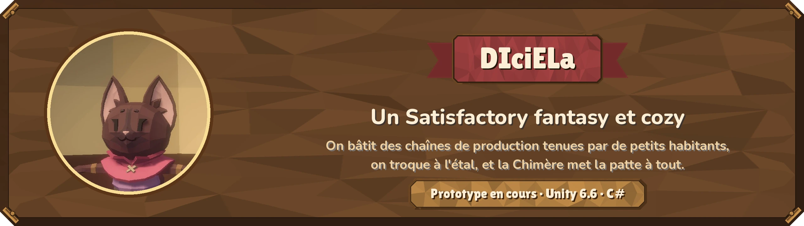

# Salut, moi c'est Mateo 👋

Étudiant à **42 Marseille**, j'aime construire des outils qui tournent pour de vrai.
Je cherche une **alternance en développement**, côté data, IA ou full-stack.

  
  

## 🎓 En deux mots

- **Ma formation** : le tronc commun du cursus 42 Next, que j'aurai fini pour mon entrée en alternance. Ensuite, en
  alternance, le titre RNCP 7 « Expert en architecture informatique », option **Architecture de bases de données et data**
  (niveau Bac+5).
- **Mon rythme** : deux semaines en entreprise, une semaine à l'école.
- **Ce que je cherche** : une équipe où je construis des outils qui servent vraiment, et avec qui j'aurais envie de continuer
  après l'alternance.

## 🛠️ Mes projets

<table>
  <tr>
    <td width="50%" valign="top">
      
      <h3><a href="https://github.com/SNZMTO/honear">Honear</a></h3>
      Un blind test multijoueur, en ligne sur <a href="https://honear.fr">honear.fr</a> : un écran pour la tablée, un
      téléphone chacun. TypeScript strict, WebSocket, 523 tests, Docker durci, registre RGPD.
    </td>
    <td width="50%" valign="top">
      
      <h3><a href="https://github.com/SNZMTO/DIciELa">DIciELa</a></h3>
      Un jeu de chaînes de production, fantasy et cozy, en prototype sous Unity. Une simulation en C# pur vérifiée par
      540 tests, et tout un cadre pour garder le projet cohérent : règles, procédures, garde-fou, décisions numérotées.
    </td>
  </tr>
</table>

## 🏫 À 42

Le code de ces projets reste privé.

| Projet | Langage | Domaine | En bref |
| --- | --- | --- | --- |
| **libft** | C | Bibliothèque | Réécrire les fonctions de base de la libc : chaînes, mémoire, listes chaînées |
| **ft_printf** | C | Fonctions variadiques | Réimplémenter `printf` et ses conversions |
| **get_next_line** | C | Entrées et sorties | Lire un fichier ligne par ligne, avec un tampon et un état gardé entre les appels |
| **push_swap** | C | Algorithmique | Trier une pile avec un jeu d'opérations limité, en un minimum de coups |
| **Growing Code** | Python | Bases | Variables, fonctions, boucles et récursion |
| **Garden Guardian** | Python | Erreurs | Lever, attraper et définir ses propres exceptions |
| **Code Cultivation** | Python | Programmation objet | Classes, héritage, encapsulation |
| **Data Quest** | Python | Structures de données | Listes, dictionnaires, ensembles, générateurs |
| **Data Archivist** | Python | Fichiers | Lire et écrire des fichiers, gestionnaires de contexte |
| **The Codex** | Python | Modules et paquets | Organiser un projet en paquets, gérer les imports |
| **Code Nexus** | Python | Abstraction | Classes abstraites et polymorphisme, autour d'un pipeline de données |
| **Cosmic Data** | Python | Validation de données | Modèles Pydantic et énumérations |
| **The Matrix** | Python | Environnement | Environnements virtuels, variables d'environnement, dépendances |
| **A-Maze-ing** | Python | Algorithmique | Générer un labyrinthe à partir d'un fichier de configuration |
| **Pac-Man** | Python, Pygame | Jeu, en binôme | Un Pac-Man jouable, sur les labyrinthes d'A-Maze-ing |

## ⚙️ Comment je travaille

- **À 42, tout à la main.** Du C et du Python, sans assistant : libft, ft_printf, get_next_line, push_swap, puis les
  modules Python. Chaque projet est corrigé par d'autres étudiants, qui me font expliquer mon code.
- **Sur mes projets perso, avec un assistant de code.** Je conçois, je découpe le code en couches, j'écris les règles et les
  tests qui les verrouillent, et j'utilise Claude Code pour écrire plus vite. Je relis, j'essaie sur de vrais appareils, et
  je tranche. Chaque projet dit qui a fait quoi.

## 🧰 Ce que j'utilise

  
  
  
  
  
  
  
  
  
  

## 📚 Hors code

Grand lecteur de fantasy et de science-fiction. Mes trois sagas préférées : *Dungeon Crawler Carl*, *Red Rising* et
*Shadow Slave*.
